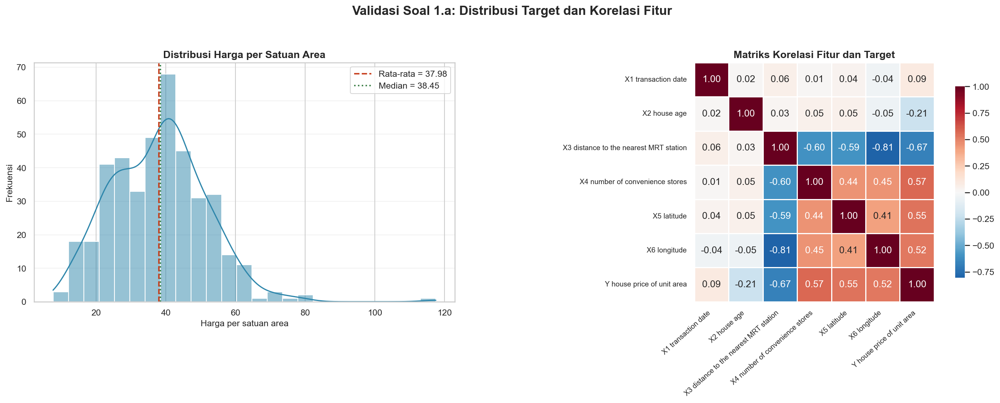
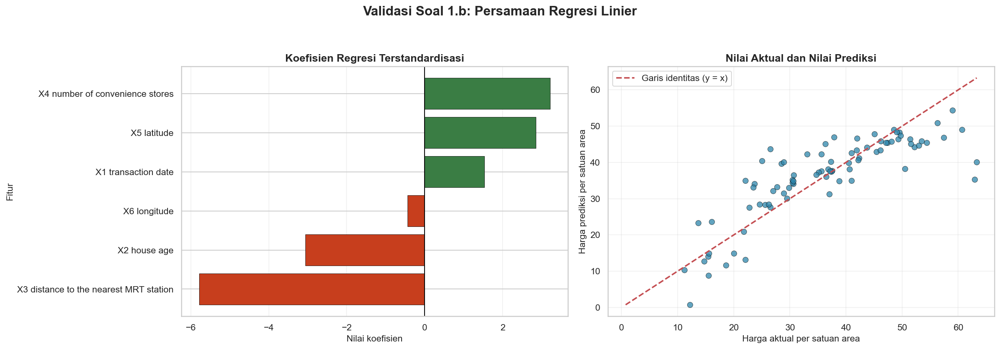
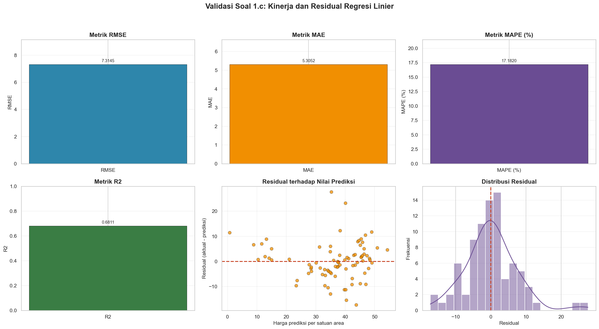
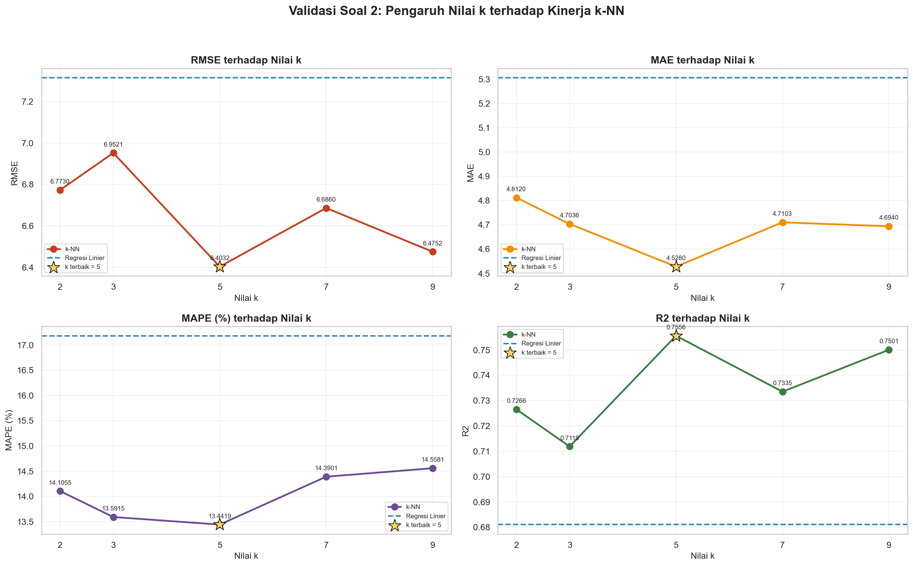
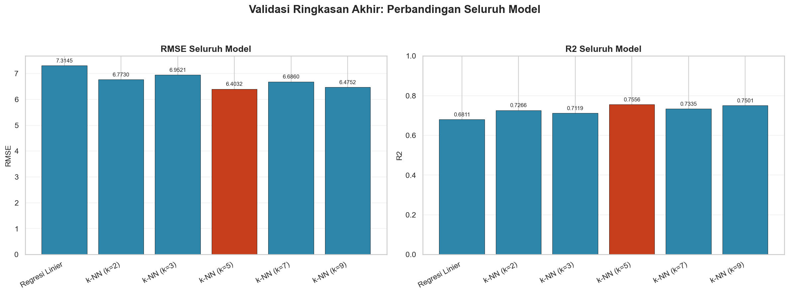
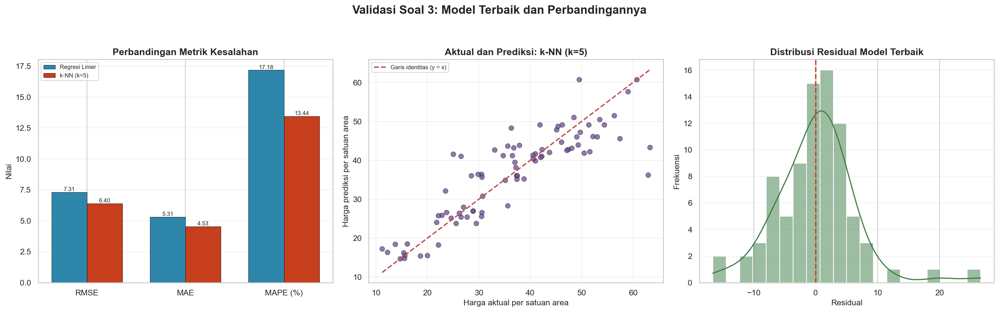

# Studi Kasus Data Mining: Regresi Valuasi Real Estat

Repositori ini memuat pengerjaan studi kasus Data Mining untuk memprediksi harga properti
menggunakan **Regresi Linier** dan **k-Nearest Neighbors Regression (k-NN)**. Seluruh
proses, mulai dari eksplorasi data, pelatihan model, hingga evaluasi, disajikan secara
lengkap di dalam buku kerja Jupyter dan diringkas pada dokumen ini.

## Identitas Penyusun

| Keterangan | Isi |
|---|---|
| Nama | Brian Aryansyah Pamungkas |
| NIM | A11.2024.15880 |
| Kelas | A11.4513 |
| Mata Kuliah | Data Mining |
| Program Studi | Teknik Informatika |
| Institusi | Universitas Dian Nuswantoro |

## Ringkasan Hasil

- Dataset terdiri atas **414 observasi** dan **8 kolom** tanpa nilai kosong.
- Model **k-NN dengan k = 5** merupakan model terbaik dengan **RMSE 6,4032**,
  **MAE 4,5280**, **MAPE 13,44 persen**, dan **R² 0,7556**.
- Model **Regresi Linier** menghasilkan **RMSE 7,3145**, **MAE 5,3052**,
  **MAPE 17,18 persen**, dan **R² 0,6811**.
- Dibandingkan Regresi Linier, k-NN dengan k = 5 menurunkan RMSE sebesar **12,46 persen**
  dan meningkatkan R² sebesar **0,0745**.

## Daftar Isi

1. [Deskripsi Dataset](#deskripsi-dataset)
2. [Metodologi](#metodologi)
3. [Hasil dan Pembahasan](#hasil-dan-pembahasan)
4. [Validasi Visual](#validasi-visual)
5. [Kesimpulan](#kesimpulan)
6. [Struktur Repositori](#struktur-repositori)
7. [Cara Menjalankan](#cara-menjalankan)
8. [Referensi](#referensi)

## Deskripsi Dataset

Dataset yang digunakan adalah **Real Estate Valuation** dari UCI Machine Learning
Repository. Dataset ini berisi transaksi properti di Distrik Sindian, New Taipei City,
Taiwan. Variabel target penelitian adalah harga rumah per satuan luas area.

| Kode | Nama Kolom | Deskripsi | Satuan |
|---|---|---|---|
| X1 | `X1 transaction date` | Tanggal transaksi | Tahun desimal |
| X2 | `X2 house age` | Usia rumah | Tahun |
| X3 | `X3 distance to the nearest MRT station` | Jarak ke stasiun MRT terdekat | Meter |
| X4 | `X4 number of convenience stores` | Jumlah minimarket di sekitar properti | Unit |
| X5 | `X5 latitude` | Garis lintang lokasi properti | Derajat |
| X6 | `X6 longitude` | Garis bujur lokasi properti | Derajat |
| Y | `Y house price of unit area` | Harga rumah per satuan luas area | 10.000 dolar Taiwan per ping |

Kolom `No` tidak digunakan sebagai fitur karena hanya berupa nomor urut observasi.
Kolom tersebut tidak memiliki makna prediktif dan berpotensi menimbulkan kebocoran
informasi semu apabila urutan baris berkorelasi dengan waktu pengambilan sampel.

### Statistik Deskriptif

| Variabel | Rata-rata | Simpangan Baku | Minimum | Maksimum |
|---|---:|---:|---:|---:|
| X1 transaction date | 2.013,1490 | 0,2820 | 2.012,6667 | 2.013,5833 |
| X2 house age | 17,7126 | 11,3925 | 0,0000 | 43,8000 |
| X3 distance to the nearest MRT station | 1.083,8857 | 1.262,1096 | 23,3828 | 6.488,0210 |
| X4 number of convenience stores | 4,0942 | 2,9456 | 0,0000 | 10,0000 |
| X5 latitude | 24,9690 | 0,0124 | 24,9321 | 25,0146 |
| X6 longitude | 121,5334 | 0,0153 | 121,4735 | 121,5663 |
| Y house price of unit area | 37,9802 | 13,6065 | 7,6000 | 117,5000 |

## Metodologi

1. **Pemuatan data.** Dataset dimuat dari berkas Excel. Pemeriksaan dimensi, tipe data,
   nilai kosong, dan statistik deskriptif dilakukan pada tahap awal.
2. **Penentuan fitur dan target.** Enam fitur prediktor digunakan, sedangkan kolom `No`
   dihapus. Variabel target adalah `Y house price of unit area`.
3. **Pembagian data.** Data dibagi menjadi **80 persen data latih** sebanyak 331 baris
   dan **20 persen data uji** sebanyak 83 baris dengan `random_state = 42`.
4. **Penskalaan fitur.** `StandardScaler` di-*fit* hanya pada data latih, kemudian
   diterapkan pada data uji untuk mencegah kebocoran data.
5. **Pelatihan model.** Regresi Linier dan k-NN dengan nilai `k = 2, 3, 5, 7, 9`
   dilatih pada data latih yang telah distandardisasi.
6. **Evaluasi.** Kinerja diukur menggunakan RMSE, MAE, MAPE, dan R² pada data uji yang
   identik untuk seluruh model.
7. **Pemilihan model.** Model terbaik dipilih berdasarkan RMSE terkecil dengan tetap
   mempertimbangkan MAE, MAPE, R², kestabilan, dan interpretabilitas.

## Hasil dan Pembahasan

### Soal 1.a: Fitur Prediktor dan Variabel Target

Fitur prediktor terdiri atas `X1` sampai `X6`, sedangkan variabel target adalah
`Y house price of unit area`. Korelasi fitur terhadap target diurutkan berdasarkan
nilai absolut sebagai berikut.

| Fitur | Korelasi dengan Target |
|---|---:|
| X3 distance to the nearest MRT station | -0,6736 |
| X4 number of convenience stores | 0,5710 |
| X5 latitude | 0,5463 |
| X6 longitude | 0,5233 |
| X2 house age | -0,2106 |
| X1 transaction date | 0,0875 |

Jarak ke stasiun MRT memiliki korelasi negatif terkuat, sedangkan jumlah minimarket
memiliki korelasi positif terkuat. Hal ini menunjukkan bahwa faktor lokasi dan
aksesibilitas berperan penting dalam menentukan harga properti.

### Soal 1.b: Persamaan Regresi Linier

Model Regresi Linier dilatih pada fitur yang telah distandardisasi. Intersep yang
diperoleh adalah **38,3915** dengan koefisien sebagai berikut.

| Fitur | Koefisien |
|---|---:|
| X1 transaction date | 1,5305 |
| X2 house age | -3,0627 |
| X3 distance to the nearest MRT station | -5,7870 |
| X4 number of convenience stores | 3,2190 |
| X5 latitude | 2,8552 |
| X6 longitude | -0,4412 |

Persamaan regresi yang terbentuk adalah:

```text
y_hat = 38,3915 + 1,5305 X1 - 3,0627 X2 - 5,7870 X3 + 3,2190 X4 + 2,8552 X5 - 0,4412 X6
```

Koefisien menunjukkan perubahan prediksi harga per satuan area apabila suatu fitur
meningkat satu simpangan baku, dengan fitur lain dianggap tetap. Jarak ke stasiun MRT
(X3) memiliki pengaruh negatif terbesar, diikuti oleh jumlah minimarket (X4) dan usia
rumah (X2).

### Soal 1.c: Evaluasi Regresi Linier

| Metrik | Nilai |
|---|---:|
| RMSE | 7,3145 |
| MAE | 5,3052 |
| MAPE | 17,18 persen |
| R² | 0,6811 |

Model Regresi Linier mampu menjelaskan sekitar **68,11 persen** varians harga per satuan
area pada data uji. Rata-rata kesalahan absolut sebesar 5,3052 satuan, sedangkan rata-rata
kesalahan relatif sebesar 17,18 persen. Residual model memiliki rata-rata 0,1237,
simpangan baku 7,3135, nilai minimum -17,2219, dan nilai maksimum 27,6322.

### Soal 2: Perbandingan k-NN untuk Berbagai Nilai k

| Model | RMSE | MAE | MAPE (persen) | R² |
|---|---:|---:|---:|---:|
| k-NN (k = 2) | 6,7730 | 4,8120 | 14,11 | 0,7266 |
| k-NN (k = 3) | 6,9521 | 4,7036 | 13,59 | 0,7119 |
| **k-NN (k = 5)** | **6,4032** | **4,5280** | **13,44** | **0,7556** |
| k-NN (k = 7) | 6,6860 | 4,7103 | 14,39 | 0,7335 |
| k-NN (k = 9) | 6,4752 | 4,6940 | 14,56 | 0,7501 |

Nilai `k = 5` memberikan RMSE terkecil, MAPE terendah, dan R² tertinggi. Nilai `k = 3`
memang memiliki MAE terkecil, tetapi RMSE dan R² lebih rendah daripada `k = 5`. Hal ini
menunjukkan bahwa `k = 3` masih menghasilkan beberapa kesalahan besar. Nilai `k = 2`
rentan terhadap derau dan pencilan, sedangkan `k = 7` dan `k = 9` mulai mengalami
penghalusan berlebihan.

### Soal 3: Model Terbaik dan Alasannya

**Model terbaik adalah k-NN dengan k = 5.** Perbandingan terhadap Regresi Linier
disajikan pada tabel berikut.

| Metrik | Regresi Linier | k-NN (k = 5) | Selisih | Perbaikan Relatif |
|---|---:|---:|---:|---:|
| RMSE | 7,3145 | **6,4032** | -0,9113 | 12,46 persen |
| MAE | 5,3052 | **4,5280** | -0,7773 | 14,65 persen |
| MAPE (persen) | 17,18 | **13,44** | -3,74 | 21,77 persen |
| R² | 0,6811 | **0,7556** | +0,0745 | 10,94 persen |

Alasan pemilihan model terbaik adalah sebagai berikut.

1. **Akurasi metrik.** k-NN dengan k = 5 menghasilkan RMSE, MAE, dan MAPE terendah serta
   R² tertinggi pada data uji yang sama.
2. **Pola nonlinier dan spasial.** Hubungan antara atribut properti dan harga tidak
   sepenuhnya linier. Pengaruh jarak ke MRT, lokasi, dan interaksi antarfitur lebih tepat
   ditangkap melalui kemiripan lokal yang digunakan k-NN.
3. **Keseimbangan bias dan varians.** Nilai k = 5 cukup lokal untuk menangkap pola, tetapi
   cukup halus untuk menekan derau. Nilai k yang terlalu kecil meningkatkan varians,
   sedangkan nilai k yang terlalu besar meningkatkan bias.
4. **Pertimbangan praktis.** k-NN lebih akurat untuk prediksi, tetapi memerlukan
   penskalaan fitur, biaya prediksi lebih tinggi, dan tidak menghasilkan persamaan
   eksplisit. Regresi Linier tetap lebih unggul dalam interpretabilitas.

## Validasi Visual

### Distribusi Target dan Korelasi Fitur

Gambar berikut menunjukkan sebaran harga per satuan area serta matriks korelasi antara
fitur dan variabel target.



**Gambar 1.** Distribusi harga per satuan area dan matriks korelasi fitur terhadap target.

### Persamaan Regresi dan Kecocokan Prediksi

Gambar berikut menunjukkan arah dan besar koefisien regresi terstandardisasi serta
sebaran nilai aktual terhadap nilai prediksi.



**Gambar 2.** Koefisien regresi terstandardisasi dan perbandingan nilai aktual dengan
nilai prediksi Regresi Linier.

### Kinerja dan Residual Regresi Linier

Gambar berikut menampilkan nilai setiap metrik evaluasi, pola residual terhadap nilai
prediksi, dan distribusi residual Regresi Linier.



**Gambar 3.** Metrik evaluasi, pola residual, dan distribusi residual Regresi Linier.

### Pengaruh Nilai k terhadap Kinerja k-NN

Gambar berikut menunjukkan perubahan RMSE, MAE, MAPE, dan R² untuk setiap nilai k.
Garis putus-putus merepresentasikan kinerja Regresi Linier sebagai pembanding.



**Gambar 4.** Pengaruh nilai k terhadap RMSE, MAE, MAPE, dan R² pada model k-NN.

### Perbandingan Seluruh Model

Gambar berikut membandingkan RMSE dan R² seluruh model pada data uji. Model terbaik
ditandai dengan warna merah.



**Gambar 5.** Perbandingan RMSE dan R² seluruh model pada data uji.

### Kualitas Prediksi Model Terbaik

Gambar berikut membandingkan metrik kesalahan model terbaik terhadap Regresi Linier,
menampilkan sebaran nilai aktual terhadap nilai prediksi, dan menunjukkan distribusi
residual model terbaik.



**Gambar 6.** Perbandingan metrik, sebaran aktual-prediksi, dan distribusi residual
model terbaik, yaitu k-NN dengan k = 5.

## Kesimpulan

Model terbaik untuk dataset ini adalah **k-NN dengan k = 5**. Model tersebut menghasilkan
RMSE 6,4032, MAE 4,5280, MAPE 13,44 persen, dan R² 0,7556 pada data uji. Nilai k = 5
memberikan keseimbangan bias dan varians yang baik serta mampu menangkap pola nonlinier
dan spasial data. Regresi Linier tetap relevan sebagai model pembanding yang interpretatif
karena arah dan besar pengaruh setiap fitur dapat dibaca langsung dari koefisiennya.

## Struktur Repositori

```text
.
├── README.md
├── Real estate valuation data set.xlsx
├── Tugas_DataMining_RealEstate_Brian_Aryansyah_Pamungkas_A11.2024.15880.ipynb
├── images
│   ├── 01_distribusi_dan_korelasi.png
│   ├── 02_koefisien_regresi.png
│   ├── 03_metrik_regresi.png
│   ├── 04_knn_terhadap_k.png
│   ├── 05_perbandingan_model.png
│   └── 06_model_terbaik.png
└── scripts
    └── generate_charts.py
```

## Cara Menjalankan

Pasang dependensi yang dibutuhkan:

```bash
pip install pandas numpy scikit-learn matplotlib seaborn openpyxl
```

Jalankan buku kerja Jupyter:

```bash
jupyter notebook Tugas_DataMining_RealEstate_Brian_Aryansyah_Pamungkas_A11.2024.15880.ipynb
```

Buat ulang seluruh grafik validasi:

```bash
python scripts/generate_charts.py
```

## Referensi

- Yeh, I. C., dan Hsu, T. K. (2018). Building real estate valuation models with
  comparative approach through case-based reasoning. *Applied Soft Computing*.
- UCI Machine Learning Repository. *Real Estate Valuation Data Set*.
  [https://archive.ics.uci.edu/dataset/477/real+estate+valuation+data+set](https://archive.ics.uci.edu/dataset/477/real+estate+valuation+data+set)
- Pedregosa, F., et al. (2011). Scikit-learn: Machine Learning in Python.
  *Journal of Machine Learning Research*, 12, 2825-2830.
